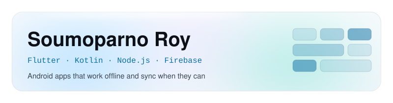

<picture>
  <source media="(prefers-color-scheme: dark)" srcset="assets/header-dark.svg">
  
</picture>

I build Android apps in Flutter, with native Kotlin where Flutter can't reach and Node.js on the server.

**Currently:** Zeolite is out on the Play Store, and I'm open to Flutter internships.

**Stack:** Flutter, Dart, Riverpod, Kotlin · Node.js, Express, MongoDB · Firebase (Auth, Firestore, App Check, Crashlytics), SQLite · Maestro

## Projects

<a href="https://play.google.com/store/apps/details?id=com.soumoparno.zeolite">
<picture>
  <source media="(prefers-color-scheme: dark)" srcset="assets/zeolite-dark.svg">
  
</picture>
</a>

Timetable and attendance tracker for Android. It works with no signal and tells you how many classes you can still miss.

- Flutter, Riverpod and SQLite, with tested database migrations
- Reads timetables off photos with on-device OCR
- Optional Firebase sync (App Check enforced) and two-way Notion sync through a Node and Express server on Render
- Home-screen widgets in Kotlin
- 1,359 Flutter, 59 server and 14 security-rules tests; 8 Maestro device flows

[Play Store](https://play.google.com/store/apps/details?id=com.soumoparno.zeolite) · [Repository](https://github.com/SoumoparnoRoy/Zeolite)

<a href="https://github.com/SoumoparnoRoy/KursKart">
<picture>
  <source media="(prefers-color-scheme: dark)" srcset="assets/kurskart-dark.svg">
  
</picture>
</a>

Multi-vendor shop app: stores, products, cart, orders and reviews.

- Flutter and Riverpod screens for customers and vendors
- REST API in Node.js, Express and MongoDB, with JWT sign-in and bcrypt-hashed passwords
- Vendor photo uploads to Cloudinary, with cleanup of unused images

[Repository](https://github.com/SoumoparnoRoy/KursKart)

## Contributions

<picture>
  <source media="(prefers-color-scheme: dark)" srcset="https://raw.githubusercontent.com/SoumoparnoRoy/SoumoparnoRoy/output/snake-dark.svg">
  
</picture>

## Contact

[LinkedIn](https://www.linkedin.com/in/soumoparno-roy)
